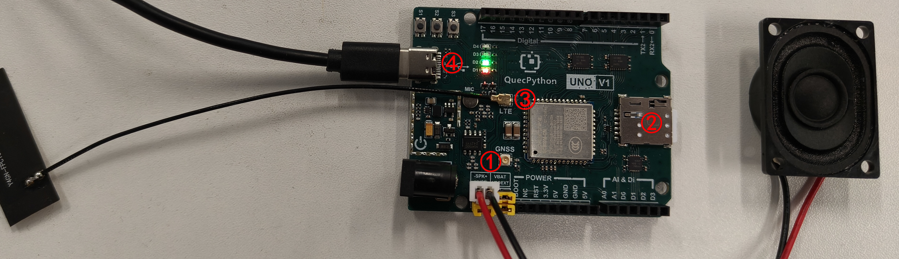

# QuecPython AI Chat

## Table of Contents

- [QuecPython AI Chat Based on Doubao Websocket](#quecpython-ai-chat-based-on-doubao-websocket)
    - [Table of Contents](#Table-of-Contents)
    
    - [Introduction](#introduction)
    
    - [Features](#Features)
    
    - [Quick Start](#Quick-Start)
        - [Prerequisites](#Prerequisites)
        
        - [Installation](#Installation)
        
        - [Running the Application](#Running-the-Application)
        
    - [Directory Structure](#Directory-Structure)

    - [Contributing](#Contributing)

    - [License](#License)

    - [Support](#Support)

## Introduction

QuecPython has launched an AI chat solution based on Doubao Websocket\. This solution implements voice dialogue based on Volcengine Websocket interface\.

The module models that support this feature are as follows:

|Series|Model|
|---|---|
|EC800M|EC800MCN\_LE|

## Features

- Supports voice question and answer \(one question one answer\)\.

- Supports independent ASR \(Automatic Speech Recognition\)\.

- Supports independent TTS \(Text\-to\-Speech\) playback\.

- Supports independent large language model\.

- Written in Python language, facilitating secondary development\.

## Quick Start

### Prerequisites

Before you begin, please ensure you have the following prerequisites:

- **Hardware:**

    - [EC800MCNLE QuecDuino Development Board](https://developer.quectel.com/doc/quecpython/Dev_board_guide/en/ec800x-duino-evb.html) \(including antenna, Type\-C data cable, etc\.\)

        > - [QuecMall Purchase Link](https://www.quecmall.com/goods-detail/2c90800c9488358b01956e1f9cfb0257)
        > 
        
    - Computer \(Windows 7, Windows 10, or Windows 11\)
    
    - Speaker
    
        - Any speaker with 2\-5W power is sufficient
    
        - [QuecMall Purchase Link](https://www.quecmall.com/goods-detail/2c90800c9488358b01956aa656680239)
    
- **Software:**

    - USB driver for QuecPython module: [QuecPython\_USB\_Driver\_Win10\_ASR](https://images.quectel.com/python/2023/04/Quectel_Windows_USB_DriverA_Customer_V1.1.13.zip)

    - Debugging tool [QPYcom](https://images.quectel.com/python/2022/12/QPYcom_V3.6.0.zip)

    - QuecPython firmware \(firmware included in the fw folder\)

    - Python text editor \(e\.g\., [VSCode](https://code.visualstudio.com/), [Pycharm](https://www.jetbrains.com/pycharm/download/)\)

### Installation

1. **Clone the repository:**

    ```bash
    git clone https://github.com/QuecPython/AIChatBot-Volcengine-websocket.git
    cd AIChatBot-Volcengine-websocket
    ```

2. **Install USB driver**

3. **Flash firmware:**
Flash the firmware to the development board according to the [instructions](https://developer.quectel.com/doc/quecpython/Getting_started/en/4G/flash_firmware.html)\.

> Before use, please update Volcengine token and other parameters through the `tiktok.config` interface first\.
> 

### Running the Application

1. **Connect the hardware:**
    Connect the hardware according to the following diagram:

  

    1. Connect the speaker to the pin headers marked `SPK+` and `SPK-` in the diagram\.
    2. Insert an available Nano SIM card in the position shown\.
    3. Connect the antenna to the antenna connector marked `LTE`\.
    4. Use a Type\-C data cable to connect the development board and the computer\.

2. **Download code to the device:**

    - Launch the QPYcom debugging tool\.

    - Connect the data cable to the computer\.

    - Press the **PWRKEY** button on the development board to start the device\.

    - Import all files in the `code` folder into the module file system according to the [instructions](https://developer.quectel.com/doc/quecpython/Getting_started/en/4G/first_python.html#Transferring-the-Script-File-to-the-Module), preserving the directory structure\.

> Note: If you need to improve the microphone sensitivity and avoid speech recognition errors, please import the `audio_gain.nvm` and `audio_ve.nvm` files under the nvm folder into the `/usr` directory of the module file system\.
> 
> 

3. **Run the application:**

    - Update parameters through the `TiktokWS.config` method\.

    - Select the `File` tab\.

    - Select the `tiktok_websocket_demo.py` script\.

    - Right\-click and select `Run` or use the `Run` shortcut button to execute the script\.

4. **Reference runtime logs:**

```python
>>>from usr.tiktokws import TiktokWS
>>>tiktok=TiktokWS()
>>>tiktok.config(ModelId='ep-20250108223254-x4r5r')
True
# Select tiktok_websocket_demo.py script and right-click to run
>>>example.exec('/usr/tiktok_websocket_demo.py')
ai start success...
please press KEY S2 to start
# Press and hold KEY S2 to start speaking
>>> please speak to ai.
# Release KEY S2 to stop speaking, then the speaker plays the response audio
speak over and wait ai response.
```

## Directory Structure

```plaintext
solution-AI/
├── code/
│   ├── ark_lib.py
│   ├── asr_lib.py
│   ├── logging.py
│   ├── ...
│   └── uwebsocket.py
├── media/
│   └── wire_connection.jpg
├── fw/
│   └── EC800MCNLER06A01M08_OCPU_QPY_TEST0228.zip
├── LICENSE
└── readme.md
```

## Contributing

We welcome contributions to improve this project\! Please follow these steps to contribute:

1. Fork this repository\.

2. Create a new branch \(`git checkout -b feature/your-feature`\)\.

3. Commit your changes \(`git commit -m 'Add your feature'`\)\.

4. Push to the branch \(`git push origin feature/your-feature`\)\.

5. Open a Pull Request\.

## License

This project uses the Apache license\. See the LICENSE file for details\.

## Support

If you have any questions or need support, please refer to the [QuecPython Documentation](https://developer.quectel.com/doc/quecpython/en/index.html) or open an issue in this repository\.

